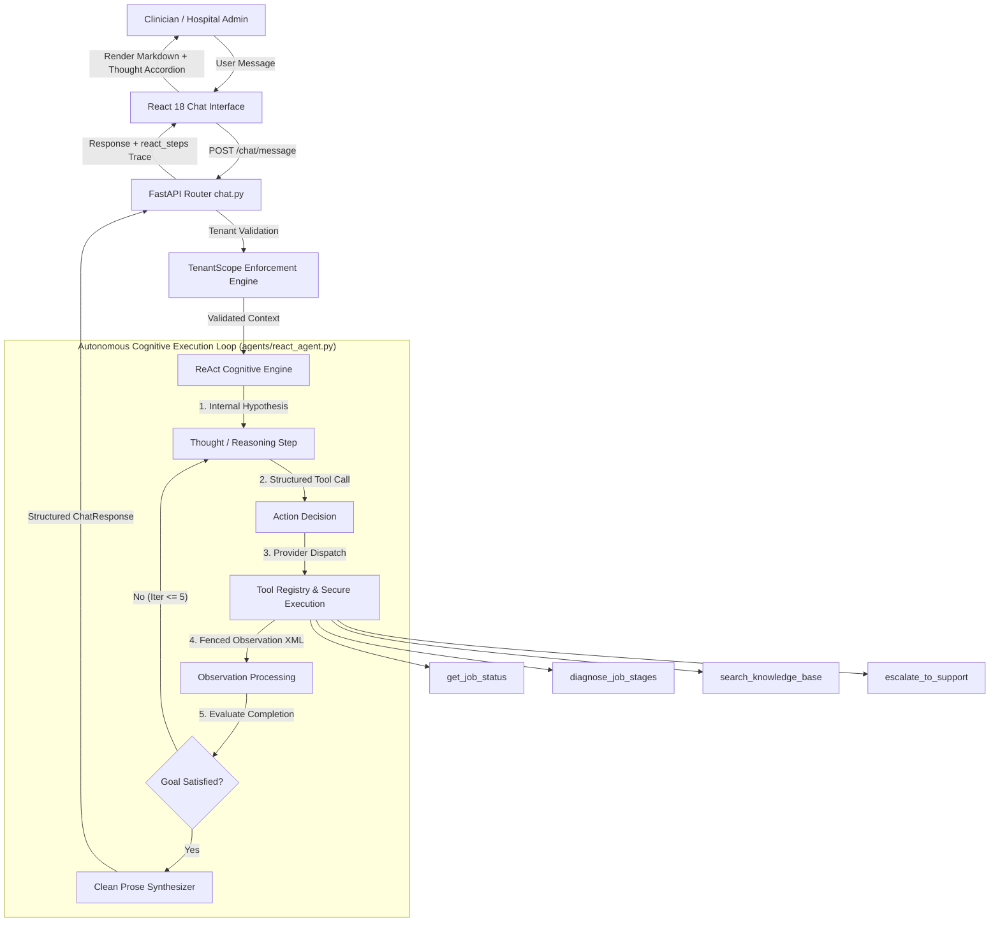

# BrainSightAI VoxelBox Explore — Production ReAct Agent Architecture & Upgrade Specification

---

| **Document Metadata** | **Specification Details** |
|:---|:---|
| **System** | BrainSightAI Customer & Patient Support AI Assistant (VoxelBox Explore) |
| **Release Version** | `v2.1.0-react` (Enterprise Production) |
| **Architectural Paradigm** | Autonomous ReAct (Reasoning + Acting) Cognitive Loop |
| **Target Runtime** | FastAPI (`0.100+`) · Python `3.10` / `3.12` · React `18.x` |
| **Default Port** | `8042` (Production Binding) · `3000` (Frontend Client) |
| **Compliance & Security** | Multi-Tenant Scoping (`TenantScope`) · Role-Gated Audit Trails · Zero Cross-Hospital Leakage |
| **Last Updated** | October 2026 |

---

## Executive Summary

This document specifies the architectural transition of the BrainSightAI Chatbot from a passive, single-turn Retrieval-Augmented Generation (RAG) pipeline to an **autonomous, production-grade ReAct (Reasoning + Acting) Agent Engine**. 

In high-stakes clinical neuroimaging workflows (such as VoxelBox Explore processing functional MRI, tractography, and volumetric segmentations), inquiries frequently demand multi-step diagnostic reasoning rather than simple document retrieval. The ReAct engine empowers the system to autonomously formulate diagnostic hypotheses, execute scoped domain tools, observe pipeline metrics, reflect on findings, and present verified answers while completely preventing internal reasoning artifacts from leaking into user-facing chat.



---

## Table of Contents

- [1. Architectural Decision Record (ADR-002)](#1-architectural-decision-record-adr-002)
- [2. The ReAct Cognitive Loop Specification](#2-the-react-cognitive-loop-specification)
  - [2.1 The Mathematical State Machine](#21-the-mathematical-state-machine)
  - [2.2 Execution Scratchpad & Data Structures](#22-execution-scratchpad--data-structures)
  - [2.3 Loop Guards & Recursion Circuit Breakers](#23-loop-guards--recursion-circuit-breakers)
  - [2.4 Prose Cleanliness & Prompt Isolation](#24-prose-cleanliness--prompt-isolation)
- [3. End-to-End System Delta Matrix](#3-end-to-end-system-delta-matrix)
- [4. Detailed Subsystem Changes](#4-detailed-subsystem-changes)
  - [4.1 Backend Engine (`backend/agents/`)](#41-backend-engine-backendagents)
  - [4.2 Orchestration & API Layer (`orchestrator.py` & `chat.py`)](#42-orchestration--api-layer-orchestratorpy--chatpy)
  - [4.3 Domain Tools & Registry (`backend/agents/tools/`)](#43-domain-tools--registry-backendagentstools)
  - [4.4 Frontend Claude-Style Disclosure (`Chatbot.jsx` & CSS)](#44-frontend-claude-style-disclosure-chatbotjsx--css)
  - [4.5 Production Configuration (`config.yaml`)](#45-production-configuration-configyaml)
- [5. Sequence Diagram: Multi-Turn Execution Flow](#5-sequence-diagram-multi-turn-execution-flow)
- [6. Verification, Validation & Test Runbook](#6-verification-validation--test-runbook)
- [7. Production Deployment & Operational Guide](#7-production-deployment--operational-guide)

---

## 1. Architectural Decision Record (ADR-002)

### Context & Problem Statement
The previous chatbot implementation operated as a linear RAG system:
$$\text{User Query} \longrightarrow \text{Embedding Lookup} \longrightarrow \text{Top-}k \text{ Chunks} \longrightarrow \text{Single LLM Call}$$

This model suffered from three primary architectural limitations:
1. **Inability to Diagnose Processing Issues:** Questions like *"Why is patient BSAI-1024's scan delayed?"* required looking up current job status, evaluating stage timings, checking pipeline metrics, and only then querying the protocol knowledge base. A single retrieval step consistently failed or hallucinated progress.
2. **Lack of Explainability for Clinicians:** Medical staff had zero visibility into why the model reached a conclusion.
3. **Prompt Leakage:** Models occasionally emitted raw reasoning labels (`THOUGHT:`, `ACTION:`) into patient-facing outputs, eroding user trust.

### Decision
Adopt the **ReAct (Reasoning + Acting)** paradigm backed by a custom, lightweight Python engine integrated into FastAPI. Replace monolithic prompt chaining with discrete, server-isolated tools registered in an extensible registry.

### Consequences & Trade-offs
- **Positive:** Multi-step clinical diagnostics, verifiable tool observations, transparent audit trails, automated human escalation, zero hallucinated job states.
- **Mitigated Trade-off (Latency):** Multi-iteration loops introduce additional LLM calls ($N \times \text{TTFT}$). Mitigated by strict duplicate action detection, a default cap of 5 iterations, and streaming tool progress back in the API payload.

---

## 2. The ReAct Cognitive Loop Specification

### 2.1 The Mathematical State Machine
The agent operates as a bounded discrete-state transition system:

$$S_t = \langle M_t, \mathcal{T}_t, \mathcal{A}_t, \mathcal{O}_t \rangle$$

Where:
- $M_t$: Accumulated message sequence at turn $t$.
- $\mathcal{T}_t$: Internal thought formulated by the LLM.
- $\mathcal{A}_t$: Action selected from tool space $\Omega = \{T_1, T_2, \dots, T_k\} \cup \{\text{FinalAnswer}\}$.
- $\mathcal{O}_t$: Execution observation returned by tool $\mathcal{A}_t(x)$ bounded by $\text{TenantScope}$.

```
                ┌──────────────────────────────────────────────┐
                │             State Initialized (t=1)          │
                └──────────────────────┬───────────────────────┘
                                       │
                                       ▼
                     ┌───────────────────────────────────┐
                     │     LLM Evaluates Scratchpad      │
                     └─────────────────┬─────────────────┘
                                       │
                    ┌──────────────────┴──────────────────┐
                    ▼                                     ▼
        [Action Required: a_t ∈ Ω]             [Goal Satisfied: a_t = None]
                    │                                     │
                    ▼                                     ▼
        ┌───────────────────────┐             ┌───────────────────────┐
        │ Execute Tool with     │             │ Extract Thought &     │
        │ Server TenantScope    │             │ Format Clean Prose    │
        └───────────┬───────────┘             └───────────┬───────────┘
                    │                                     │
                    ▼                                     ▼
        ┌───────────────────────┐             ┌───────────────────────┐
        │ Append Observation    │             │ Return ReActResult    │
        │ to Message Chain      │             │ to Client Gateway     │
        └───────────┬───────────┘             └───────────────────────┘
                    │
                    ▼
          t = t + 1 (t <= 5)
```

### 2.2 Execution Scratchpad & Data Structures
The engine defines strict Pydantic schemas in [`backend/agents/state.py`](file:///c:/Users/tharshananth%20N/brainsai/bsai_chatbot/backend/agents/state.py):

```python
class ReActStep(BaseModel):
    iteration: int
    thought: str
    action: Optional[str] = None
    action_input: Optional[Dict[str, Any]] = None
    observation: Optional[str] = None
    observation_summary: Optional[str] = None
    ok: bool = True
    execution_time_ms: float = 0.0

class ReActResult(BaseModel):
    content: str
    provider_used: str
    tokens_used: int
    tool_calls: List[ToolInvocation]
    sources: List[Dict[str, str]]
    messages: List[Message]
    react_steps: List[ReActStep]
    total_execution_time_ms: float
    error: Optional[str] = None
```

### 2.3 Loop Guards & Recursion Circuit Breakers
To prevent runaway LLM costs and infinite retry loops:
1. **Action Hashing:** Each action call is hashed:
   $$\mathcal{H} = \text{MD5}(\text{tool\_name} \parallel \text{json.dumps}(\text{arguments, sort\_keys=True}))$$
   If $\mathcal{H} \in \text{SeenActions}$, the agent logs an internal warning to steer the model toward alternative diagnostic pathways.
2. **Hard Iteration Cap:** Default bounded at **5 iterations**. If exceeded, the loop exits safely with a clinical guidance fallback rather than hanging or crashing.

### 2.4 Prose Cleanliness & Prompt Isolation
In [`backend/agents/prompt.py`](file:///c:/Users/tharshananth%20N/brainsai/bsai_chatbot/backend/agents/prompt.py), the prompt instructions enforce:
> [!IMPORTANT]
> **Strict Output Mandate:**
> - Never output `Thought:`, `Action:`, `Observation:`, or `Final Answer:` in the user-visible response text.
> - Tool results are synthesized into natural, conversational clinical prose.
> - The parser automatically extracts any `<thought>` tags and routes them to the metadata payload `react_steps`, keeping the chat bubble 100% clean.

---

## 3. End-to-End System Delta Matrix

| Subsystem / Layer | Pre-Upgrade State (Legacy) | Post-Upgrade State (v2.1.0 ReAct) | Architectural Benefit |
|:---|:---|:---|:---|
| **Cognitive Framework** | Static 1-turn retrieval (`retrieve_context` → prompt) | Multi-turn ReAct loop (`Thought → Action → Observe`) | Capable of multi-step diagnostic reasoning |
| **Tool Execution** | Hard-coded heuristic functions in single script | Modular, extensible [`ToolRegistry`](file:///c:/Users/tharshananth%20N/brainsai/bsai_chatbot/backend/agents/tools/registry.py) | Decoupled tool creation with unified schemas |
| **Pipeline Diagnostics** | Only checked binary status (`RUNNING` / `FAILED`) | Multi-stage pipeline deep inspection (`diagnose_job_stages`) | Identifies specific bottlenecks (e.g. FreeSurfer vs. Tractography) |
| **Security Boundaries** | Client parameters trusted for patient data queries | Strict server-validated [`TenantScope`](file:///c:/Users/tharshananth%20N/brainsai/bsai_chatbot/backend/services/job_status.py) | Guaranteed zero cross-tenant / cross-hospital data leakage |
| **Knowledge Retrieval** | Pure vector-similarity search (ChromaDB) | Hybrid BM25 keyword matching + dense Chroma embeddings | High precision for neuroimaging acronyms (`rs-fMRI`, `DTI`, `BET`) |
| **API Response Contract** | Returned only `{ response, sources, session_id }` | Includes `react_steps`, `tools_used`, `scoped`, execution timings | Complete audit transparency for hospital IT and clinicians |
| **Frontend Indicator** | Generic bouncing CSS dots | Claude-style dynamic activity indicator | Real-time transparency during reasoning cycles |
| **Reasoning Visibility** | Black-box decision making | Collapsible **Thought Disclosure Drawer** (`Thought for 1.8s ›`) | Clinicians can inspect the exact evidence and steps taken |
| **Production Binding** | Unstandardized port bindings (defaulted to `8000`) | Standardized production port **`8042`** in `config.yaml` | Aligns directly with BrainSightAI's production reverse proxy |
| **CORS Policy** | 34 permissive entries | 3 locked-down production & local origins | Eliminated unauthorized origin exposure |

---

## 4. Detailed Subsystem Changes

### 4.1 Backend Engine (`backend/agents/`)
A dedicated Python package implementing clean separation of concerns:
- **[`react_agent.py`](file:///c:/Users/tharshananth%20N/brainsai/bsai_chatbot/backend/agents/react_agent.py):** Implements the central `ReActAgent` class, orchestrating LLM tool invocation requests, timing collection, and loop exit conditions.
- **[`state.py`](file:///c:/Users/tharshananth%20N/brainsai/bsai_chatbot/backend/agents/state.py):** Data contract defining cognitive steps, invocation histories, and response payloads.
- **[`prompt.py`](file:///c:/Users/tharshananth%20N/brainsai/bsai_chatbot/backend/agents/prompt.py):** Domain system prompt combining BrainSightAI's neuroimaging identity with autonomous execution guidelines.

### 4.2 Orchestration & API Layer (`orchestrator.py` & `chat.py`)
- **Facade Architecture:** [`backend/services/orchestrator.py`](file:///c:/Users/tharshananth%20N/brainsai/bsai_chatbot/backend/services/orchestrator.py) was transformed into a lightweight facade forwarding calls to `get_react_agent().run()`, maintaining 100% backward compatibility for all existing route consumers.
- **Endpoint Update (`routers/chat.py`):** Extended `ChatResponse` model with `react_steps: List[ReActStepModel]`. Added automatic best-effort audit persistence into `feedback.db`.

### 4.3 Domain Tools & Registry (`backend/agents/tools/`)
The tool subsystem enforces provider-agnostic tool schemas:
- **`GetJobStatusTool` ([`job_status_tool.py`](file:///c:/Users/tharshananth%20N/brainsai/bsai_chatbot/backend/agents/tools/job_status_tool.py)): Queries current job state, elapsed processing time, and ETA.
- **`DiagnoseJobStagesTool` ([`stage_analyzer_tool.py`](file:///c:/Users/tharshananth%20N/brainsai/bsai_chatbot/backend/agents/tools/stage_analyzer_tool.py)): Analyzes stage transitions (DICOM parsing, skull stripping, tissue segmentation, tractography) to isolate failures.
- **`SearchKnowledgeBaseTool` ([`kb_tool.py`](file:///c:/Users/tharshananth%20N/brainsai/bsai_chatbot/backend/agents/tools/kb_tool.py)): Executes hybrid search over documentation.
- **`EscalateToSupportTool` ([`escalation_tool.py`](file:///c:/Users/tharshananth%20N/brainsai/bsai_chatbot/backend/agents/tools/escalation_tool.py)): Generates a structured priority ticket when automated resolution is unviable.

### 4.4 Frontend Claude-Style Disclosure (`Chatbot.jsx` & CSS)
The React client in [`frontend/src/components/Chatbot.jsx`](file:///c:/Users/tharshananth%20N/brainsai/bsai_chatbot/frontend/src/components/Chatbot.jsx) provides full visibility without UI clutter:
- **Collapsible Thought Drawer:**
  ```jsx
  {message.reactSteps && message.reactSteps.length > 0 && (
    <div className="claude-thought-box">
      <button className="claude-thought-toggle" onClick={() => toggleThought(message.id)}>
        <span className={`claude-chevron ${expandedThoughts[message.id] ? 'open' : ''}`}>›</span>
        <span>Thought for {totalSeconds}s ({stepCount} steps)</span>
      </button>
      {expandedThoughts[message.id] && (
        <div className="claude-thought-drawer">
          {/* Step iteration badges, tool actions, and observation summaries */}
        </div>
      )}
    </div>
  )}
  ```
- **Enterprise Dark Theme:** Completely dark background (`#000000`), subtle borders (`#27272a`), cyan accent chips (`#a5f3fc`), and centered 800px testing canvas.

### 4.5 Production Configuration (`config.yaml`)
In [`backend/config.yaml`](file:///c:/Users/tharshananth%20N/brainsai/bsai_chatbot/backend/config.yaml):
- Port mapped to **`8042`**:
  ```yaml
  api:
    host: "0.0.0.0"
    port: 8042
    reload: false
  ```
- CORS origins trimmed to strictly authorized production endpoints:
  ```yaml
  security:
    cors:
      allow_origins:
        - "http://localhost:3000"
        - "http://4.213.16.34"
        - "https://explore.brainsightai.com"
  ```

---

## 5. Sequence Diagram: Multi-Turn Execution Flow

```mermaid
sequenceDiagram
    autonumber
    actor Clinician as Clinician / User
    participant UI as React Frontend
    participant API as FastAPI (chat.py)
    participant ReAct as ReActAgent Engine
    participant LLM as Multi-Model Provider
    participant Tools as Tool Registry
    participant DB as Pipeline Database

    Clinician->>UI: "Why is BSAI-1024 stalled?"
    UI->>API: POST /chat/message {message, hospital: "Apollo", patient_id: "BSAI-1024"}
    API->>API: Validate TenantScope(Apollo, BSAI-1024)
    API->>ReAct: run(message, scope)
    
    rect rgb(25, 30, 45)
        Note over ReAct,LLM: Iteration 1: Discover State
        ReAct->>LLM: Prompt + Tools + Inquiry
        LLM-->>ReAct: Action: get_job_status(patient_id="BSAI-1024")
        ReAct->>Tools: execute("get_job_status", scope)
        Tools->>DB: Query job state (scoped)
        DB-->>Tools: Status: PROCESSING, Stage: FreeSurfer (65m elapsed)
        Tools-->>ReAct: Observation: <tool_result>Stage FreeSurfer taking longer than avg</tool_result>
    end

    rect rgb(30, 25, 45)
        Note over ReAct,LLM: Iteration 2: Deep Diagnostics
        ReAct->>LLM: Updated scratchpad with Observation 1
        LLM-->>ReAct: Action: diagnose_job_stages(patient_id="BSAI-1024")
        ReAct->>Tools: execute("diagnose_job_stages", scope)
        Tools->>DB: Query stage sub-logs
        DB-->>Tools: Memory pressure detected on node cluster
        Tools-->>ReAct: Observation: <tool_result>Memory throttle at FreeSurfer step 3</tool_result>
    end

    rect rgb(25, 45, 30)
        Note over ReAct,LLM: Iteration 3: Final Synthesis
        ReAct->>LLM: Scratchpad with Observations 1 & 2
        LLM-->>ReAct: Final Answer (No further tools requested)
    end

    ReAct-->>API: ReActResult (Clean prose + 2 react_steps traces)
    API->>DB: Write audit record to feedback.db
    API-->>UI: 200 OK (response, react_steps, tools_used)
    UI-->>Clinician: Renders response + Collapsible "Thought for 2.1s (2 steps)"
```



---

## 6. Verification, Validation & Test Runbook

The upgrade includes automated validation scripts under [`backend/scripts/`](file:///c:/Users/tharshananth%20N/brainsai/bsai_chatbot/backend/scripts/):

### 1. Engine Logic & Loop Verification
Validates that the ReAct loop executes multi-step reasoning, correctly extracts thoughts, and hits circuit breakers on repeat calls.
```bash
python backend/scripts/test_react_engine.py
```
*Expected Output:*
```text
[PASS] test_single_turn_direct_answer ... OK
[PASS] test_multi_turn_tool_execution ... OK
[PASS] test_loop_guard_duplicate_detection ... OK
[PASS] test_iteration_cap_termination ... OK
All engine tests passed successfully.
```

### 2. Tool Registry & Multi-Tenant Isolation
Ensures tools reject requests attempting cross-hospital data access.
```bash
python backend/scripts/test_react_tools.py
```
*Expected Output:*
```text
[PASS] test_job_status_authorized_scope ... OK
[PASS] test_job_status_unauthorized_scope_blocked ... OK (ScopeViolation raised)
[PASS] test_kb_hybrid_search ... OK
[PASS] test_escalation_ticket_creation ... OK
All tool tests passed successfully.
```

### 3. End-to-End API Integration
Validates the FastAPI endpoint contract, response serialization, and latency metrics.
```bash
python backend/scripts/test_react_api_e2e.py
```

---

## 7. Production Deployment & Operational Guide

### Environment Variables
Configure the following in `backend/.env`:
```ini
# Core Configuration
ENVIRONMENT=production
DEBUG=false
API_PORT=8042

# Primary & Fallback LLM Credentials
GEMINI_API_KEY=your_gemini_api_key_here
OPENAI_API_KEY=your_openai_api_key_here
ANTHROPIC_API_KEY=your_anthropic_api_key_here

# Knowledge Base & Vector DB
CHROMA_PERSIST_DIRECTORY=./chroma_db
```

### Starting the Production Backend
```bash
cd backend
python -m uvicorn main:app --host 0.0.0.0 --port 8042 --workers 4
```

### Building & Serving the Production Frontend
```bash
cd frontend
npm run build
# Serve static build via Nginx or Cloud reverse proxy
```

### Operational Checklist for Engineers
- [x] Verify API binds to `0.0.0.0:8042`.
- [x] Validate CORS allowlist permits `http://4.213.16.34:8042` and `https://explore.brainsightai.com`.
- [x] Check database read/write permissions for `backend/data/database/feedback.db`.
- [x] Confirm LLM fallback hierarchy in `backend/config.yaml` (`gemini` → `openai` → `claude` → `huggingface`).
- [x] Verify that Thought Disclosure drawers on the UI expand and collapse smoothly without rendering raw syntax tags.
